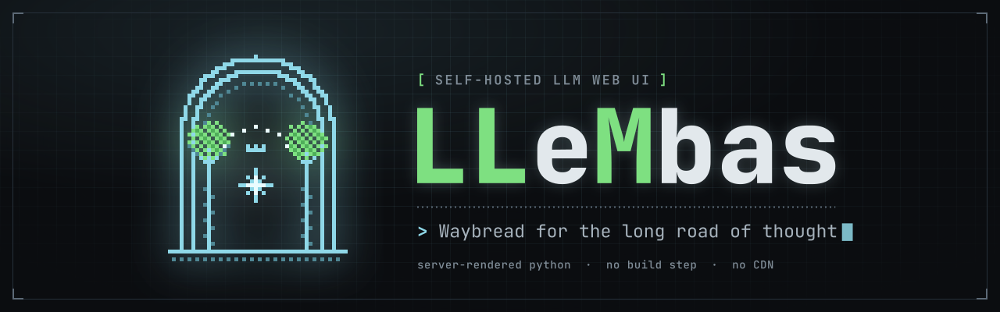

<p align="center">
  
</p>

<p align="center">
  <strong>A self-hosted web UI for your language models, written in Python.</strong><br>
  Talks to anything that speaks the OpenAI API. Themed after Middle-earth.
</p>

---

LLeMbas is a server-rendered web application for chatting with language models
you run yourself or reach over an API: chats in folders, a library of
documents, notes and skills with search, tools and web search, agent chats that
run on your own machines through the [LLeMbas CLI](https://github.com/LLeMbas/LLeMbas-CLI),
accounts with credits and usage, and an OpenAI-compatible API of its own. It is
Python and FastAPI with htmx — no bundler, no build step, nothing fetched from a
CDN at runtime — and keeps everything in one SQLite database.

## Quick start

With Docker. The compose file builds the image locally from the checkout:

```bash
git clone https://github.com/LLeMbas/LLeMbas.git && cd LLeMbas
echo "LEMBAS_SECRET_KEY=$(python3 -c 'import secrets;print(secrets.token_urlsafe(48))')" > .env
docker compose up -d --build
```

It listens on `127.0.0.1:8080`. Open it, create the first account — it becomes
the administrator — and add a connection to your models. Keep the secret key:
changing it signs everyone out and makes stored API keys unreadable. Other
settings are in [`.env.example`](.env.example).

Put a TLS reverse proxy in front for anything beyond your own machine: the
service worker and the microphone need HTTPS.

**Updating:**

```bash
git pull && docker compose up -d --build
```

**On a machine of its own** (systemd and nginx, or a Proxmox container): see
[`deploy/README.md`](deploy/README.md) and <https://llembas.eu/server.html>.

## Links

- **Documentation:** <https://llembas.eu/docs/>
- **Changelog:** <https://llembas.eu/changelog.html>
- **The CLI:** <https://github.com/LLeMbas/LLeMbas-CLI>

## Licence

[MIT](LICENSE).

## A note on the theme

This is an independent project, themed as an affectionate nod to J.R.R.
Tolkien's world. It is **not affiliated with, endorsed by, or connected to** the
Tolkien Estate, Middle-earth Enterprises, or any related rights holder. All
artwork here is original.
